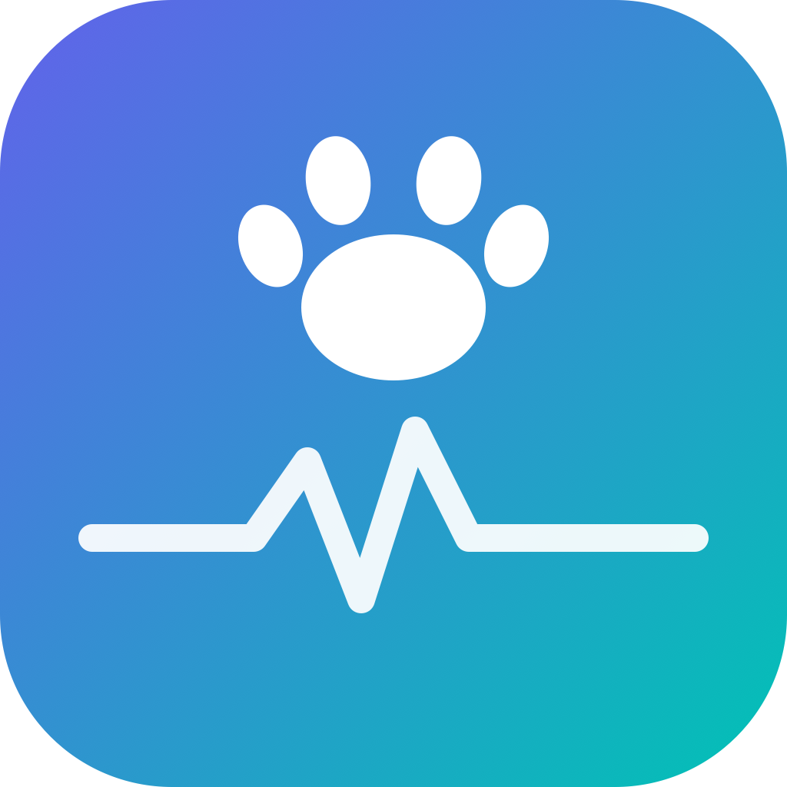

<p align="center"></p>

# CatWalk

An in-app network inspector for iOS, with no third-party dependencies. It captures the app's HTTP(S)
traffic and shows it in a searchable list with request, response, headers, cookies and TLS details.
It can also answer requests with mock responses. Everything is kept in memory and gone when the app exits.

- iOS 15+, Swift 6.2 toolchain, SwiftUI and UIKit hosts
- Captures `URLSession.shared` and custom sessions (Alamofire and others), including POST bodies and redirects
- TLS version, cipher suite and certificate chain with SHA-256 and SPKI pinning hashes. Your own SSL pinning keeps deciding.
- Mock rules (exact, path, prefix, contains, regex), editable in the app and created from a captured response
- Background-session transfers, observed from the session delegate (read-only)
- WebSocket connections (`URLSessionWebSocketTask`): handshake and every message in a chat-style Messages tab
- `WKWebView` pages: `fetch` and `XMLHttpRequest` calls with bodies (opt-in), and inspectable web views for Safari
- `AVPlayer` media loading: HLS playlist and segment requests (iOS 18+) and playback log entries (before iOS 18)
- Timing waterfall per request: DNS, connect, TLS, send, wait, receive
- Filters, JSON tree, copy as cURL, HAR export (with timings), request replay
- Compiled out of Release builds by default

## Install

Swift Package Manager:

```swift
.package(url: "https://github.com/alifu/CatWalk.git", branch: "main")
```

Add the `CatWalk` library to your app target.

## Set up

Call `start` early in launch. Sessions created before it are still captured: CatWalk hooks
`URLSessionConfiguration.default` / `.ephemeral` when the app binary loads (before `main`) and stays
inactive until `start`. To leave configurations untouched until `start`, add `CatWalkEarlyInstall = NO`
to your Info.plist. Requests already running when `start` is called are not captured.

```swift
import CatWalk

@main
struct MyApp: App {
    init() {
        CatWalk.start(configuration: CWConfiguration(triggers: [.shake, .floatingBubble]))
    }
    var body: some Scene { WindowGroup { ContentView() } }
}
```

UIKit: call `CatWalk.start(...)` in `application(_:didFinishLaunchingWithOptions:)`.

### Opening the inspector

| How | Code |
|---|---|
| Shake the device | `triggers: [.shake]` (the default) |
| Floating bubble with a live request count | `triggers: [.floatingBubble]` |
| SwiftUI sheet | `.catWalk(isPresented: $show)` |
| UIKit, over the top view controller | `CatWalk.present()` |
| UIKit, a controller you push or present | `CatWalk.makeViewController()` |

Use `triggers: []` to open it only from your own code.

## Configuration

```swift
CWConfiguration(
    maxBodyBytes: 1_048_576,                 // kept per body; the app still gets the full body
    redactedHeaders: ["Authorization", "Proxy-Authorization"],
    interceptCustomSessions: true,           // capture sessions created after start (earlier ones: see CatWalkEarlyInstall)
    maxTransactions: 500,                    // oldest are evicted first
    maxTotalBodyBytes: 50 * 1024 * 1024,     // all captured bodies together
    ignoredHosts: ["*.analytics.example.com"],
    triggers: [.shake],
    captureWebSockets: true,                 // record URLSessionWebSocketTask handshakes and messages
    maxFramesPerConnection: 1000,            // per WebSocket; oldest messages are dropped first
    instrumentWebViews: false,               // inject the fetch/XHR reporter into every new WKWebView
    makeWebViewsInspectable: true,           // Debug default; lets Safari Web Inspector attach (iOS 16.4+)
    captureMedia: true,                      // observe AVPlayer media loading
    maxMediaRequestsPerItem: 200,            // per player item; the rest are counted, not listed
    isEnabled: true                          // feed from a remote flag to switch CatWalk off
)
```

Ignored hosts take `api.example.com` or `*.example.com` (the domain and all subdomains). Their requests never
reach CatWalk. You can edit the list at runtime with `CatWalk.ignore(host:)` and in the inspector's Settings.

## Web views

Page traffic runs in WebKit's own process, so CatWalk can't intercept it. Instead it injects a small script
that reports the page's `fetch` and `XMLHttpRequest` calls, with request and response bodies (text types only,
capped like other bodies). Turn it on for one web view, before creating it:

```swift
let configuration = WKWebViewConfiguration()
CatWalk.instrument(configuration)
let webView = WKWebView(frame: .zero, configuration: configuration)
```

or for every web view with `CWConfiguration(instrumentWebViews: true)`. These rows carry a **WEB** chip and can't
be mocked. The script only observes: arguments, return values and promises reach the page unchanged.

Not reported: images, styles, scripts, page loads, service workers, cookies (WebKit keeps them from the page),
and response headers that CORS hides. `makeWebViewsInspectable` (on in Debug) sets `isInspectable`, so Safari's
Web Inspector (Develop menu on a Mac) shows all of a web view's traffic.

## Media

`AVPlayer` loads HLS through its own stack. On iOS 18+ CatWalk subscribes to the player's AVMetrics and lists
each playlist, segment and key request (status, byte range, segment duration, server, cache hit, bytes received,
timing, TLS) with a **MEDIA** chip. Before iOS 18 it lists one row per URI from the player item's access and
error logs: bytes transferred, bitrate, stalls and failure status. Where the load already goes through a
CatWalk-observed `URLSession`, the normal row is shown and no duplicate MEDIA row is added.

Limits: no headers or bodies, no replay or mocking, `maxMediaRequestsPerItem` caps the list per item, and players
created before `CatWalk.start` are not observed. Set `captureMedia: false` to turn it off.

## Mocking

```swift
try CatWalk.mock(CWMockRule.get("/products").respond(status: 200, json: ["products": []]))
try CatWalk.mock(CWMockRule.post("https://api.example.com/login").respond(status: 401, delay: 1.5))
try CatWalk.mock(CWMockRule.get("/profile").fail(with: .notConnectedToInternet))
try CatWalk.mock(CWMockRule.matching(.regex(#"/users/\d+$"#), method: "GET").respond(status: 404))
```

- `get("/path")` matches the path on any host; a string containing `://` matches the full URL.
- Exact-URL rules are tried before pattern rules, then pattern rules in the order you added them.
- Mocked requests never reach the network and show up as **Mocked** in the list.
- In the inspector: swipe a row or use "Mock this response" to pre-fill a rule from a captured response; the
  **Mocks** screen enables, edits and deletes rules.
- Rules last until the app exits, so register the ones you want in code at launch.

## Release builds

The inspector is compiled in for **Debug** builds only. In Release every `CatWalk` API still exists but does
nothing (no `URLProtocol` registered, no swizzling, no UI), so you don't need `#if` in your app, and
`CatWalk.isEnabled` is `false`.

To keep it in a Release build, for example for QA or TestFlight, enable the package trait:

```swift
.package(url: "https://github.com/alifu/CatWalk.git", branch: "main", traits: ["CatWalkAlwaysOn"])
```

Use `CWConfiguration(isEnabled:)` or `CatWalk.setEnabled(_:)` as a runtime kill switch on top of that.

## Privacy

- Captured data lives in memory only. Nothing is written to disk, and everything is erased when the app exits.
- `Authorization` and `Proxy-Authorization` values are replaced by a placeholder before they are stored.
  Add `Cookie` and `Set-Cookie` to `redactedHeaders` to hide cookie values too, or pass `[]` to see everything.
- Request bodies and URLs are captured as sent. Don't ship a Release build with the trait on to end users.

## Limitations

What each source captures, and what it can't:

| Source | Chip | Captured | Not captured |
|---|---|---|---|
| `URLSession` (shared, custom, Alamofire) | | Requests, bodies, redirects, timing, TLS; mockable and replayable | Requests already running when `CatWalk.start` is called; sessions whose `protocolClasses` the app sets itself |
| Background sessions | BG | Request, response, timing and TLS once the transfer finishes; download and upload bodies | Mocking; rows appear only after the transfer |
| `URLSessionWebSocketTask` | WS | Handshake, every message (text, binary, ping/pong), close code | Mocking; a peer close shows when the app next calls `receive()` |
| `WKWebView` | WEB | `fetch` and XHR calls with text bodies, for instrumented web views | Images, styles, scripts, page loads, service workers, cookies; use Safari Web Inspector for those |
| `AVPlayer` | MEDIA | iOS 18+: playlist, segment and key requests with timing; before iOS 18: per-URI playback and error logs | Headers, bodies, mocking; players created before `start` |

Background sessions bypass `URLProtocol`, so CatWalk observes them from the session delegate. Download bodies
are read from the file before your delegate receives it; upload bodies come from the file passed to
`uploadTask(with:fromFile:)`. WebSocket tasks are observed by hooking the task's runtime class, and HAR export
includes their messages in Chrome's `_webSocketMessages` format.

Out of reach:

- Network.framework (`NWConnection`) and libraries built on it, such as Starscream's native engine or gRPC-Swift
- Traffic of other processes: app extensions, widgets, WebContent subresources, push

Use the **Source** menu in the filter bar to show one kind of traffic. Settings has switches for WebSockets,
AVPlayer media and web views, and shows whether the load-time install ran.

## Development

```sh
xcodebuild test -scheme CatWalk -destination 'platform=iOS Simulator,name=iPhone 17'
```

`docs/icon.svg` is the source of the icon; the asset catalog holds a vector PDF of the same artwork.
